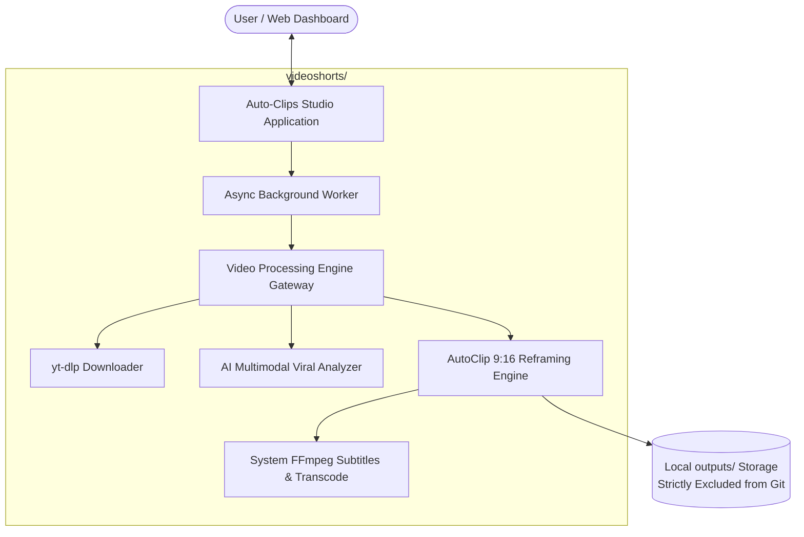

# 🎬 Auto-Clips (VideoShorts AI)

<div align="center">


**Autonomous AI studio that transforms long videos and YouTube links into viral 9:16 vertical shorts with animated subtitles.**

[Features](#-key-features) • [Architecture](#-architecture) • [Getting Started](#-getting-started) • [Testing](#-testing) • [Roadmap](TODO.md)

</div>

---

## 🌟 Overview

**Auto-Clips** is a full-stack, automated video intelligence application that takes long-form video content (podcasts, interviews, webinars, gaming streams, tutorials) or YouTube URLs, identifies the most engaging and viral moments using **Google Gemini multimodal AI**, crops them into **9:16 vertical format**, and burns dynamic, word-timed subtitles tailored for **YouTube Shorts**, **TikTok**, and **Instagram Reels**.

It features a reactive dark-mode web studio dashboard with real-time live progress tracking, an interactive clip preview player, and instant MP4 downloads.

---

## 🔒 Media Privacy & Output Policy

> **Important**: None of the generated video shorts, downloaded source videos, or rendered audio files are tracked or uploaded to the Git repository. All media generation happens locally in your isolated `outputs/` folder, which is strictly excluded via `.gitignore`. Your media assets remain 100% private on your machine.

---

## ✨ Key Features

- 🔗 **Direct YouTube Ingestion**: Built-in YouTube downloading with automatic subtitle extraction, fallback transcription, and automatic 10-minute segmenting for long videos to prevent quota exhaustion.
- 📁 **Local Video Drag-and-Drop**: Upload MP4, MOV, MKV, WebM, and AVI videos directly through the web studio.
- 🧠 **Multimodal Viral AI Scoring**: Powered by `gemini-3.1-flash-lite` / `gemini-1.5-flash`. The model evaluates:
  - **Hook Strength** (first 3-5 seconds engagement)
  - **Narrative Arc & Clarity** (standalone comprehension)
  - **Emotional Impact & Virality Potential** (0.00 – 1.00 score)
  - **Pacing & Punchiness**
- 📐 **Smart 9:16 Vertical Reframing**: Converts standard 16:9 widescreen video to 9:16 portrait using intelligent framing via the AutoClip engine.
- 💬 **Dynamic Timed Subtitles**: Word-level synchronised subtitles with high-contrast styling and customizable presets.
- 📱 **Multi-Platform Presets**: Custom output tuning for:
  - **YouTube Shorts** (`youtube_shorts`)
  - **TikTok** (`tiktok`)
  - **Instagram Reels** (`instagram_reels`)
  - **Douyin** (`douyin`)
- ⚡ **Reactive Real-Time Dashboard**:
  - Live progress bars and real-time logs during processing.
  - Built-in video player to preview generated vertical shorts.
  - One-click individual MP4 downloads.
  - Job history and state persistence.
- 🛡️ **Enterprise-Grade Security**:
  - Full SSRF protection against internal/metadata IPs.
  - Strict path traversal prevention.
  - Subprocess timeouts and process tree cleanup.
  - Validated file upload headers and MIME checks.

---

## 🏗️ Architecture



---

## 📁 Repository Structure

```text
Auto-clips/
├── autoclip-1.5.6-py3-none-any.whl  # Core AutoClip engine Python package
├── GEMINI.md                        # Application state & agent operational baseline
├── README.md                        # Project documentation (this file)
├── TODO.md                          # Detailed roadmap & upcoming features
├── .gitignore                       # Clean Git exclusion rules
│
└── videoshorts/                     # Main Web Application & Service
    ├── app/
    │   ├── main.py                  # Web application entry point
    │   ├── config.py                # Environment configuration & settings
    │   ├── database.py              # Database setup & models
    │   ├── services/
    │   │   ├── engine.py            # Processing engine adapter & yt-dlp
    │   │   └── worker.py            # Background job processing queue
    │   ├── static/                  # CSS styles, icons, fonts
    │   └── templates/
    │       └── index.html           # Glassmorphic single-page studio dashboard
    ├── scripts/                     # Maintenance, migration & worker scripts
    ├── tests/                       # Unit, integration & security tests
    ├── pytest.ini                   # Pytest configuration
    ├── requirements.txt             # App dependencies
    └── .env.example                 # Sample environment variables
```

---

## 🚀 Getting Started

### 1. Prerequisites
- **Python**: Version 3.10 or higher.
- **FFmpeg**: FFmpeg 5.0+ installed and accessible in your system `PATH` (e.g. `ffmpeg -version`).
- **AI Credentials**: A valid Google Gemini API key.

### 2. Environment Setup

#### Step A: Set Up the AutoClip Engine Virtual Environment
The AutoClip processing engine runs in an isolated virtual environment at the repository root:

```bash
# From the root directory: Auto-clips/
python -m venv autoclip-venv

# Activate the venv:
# On Windows (PowerShell):
.\autoclip-venv\Scripts\Activate.ps1
# On Linux / macOS:
source autoclip-venv/bin/activate

# Install the included AutoClip engine wheel:
pip install autoclip-1.5.6-py3-none-any.whl

# Verify the CLI is available:
autoclip --version
deactivate
```

#### Step B: Set Up the Web Studio
```bash
# Navigate into the videoshorts directory:
cd videoshorts

# Create and activate project virtual environment:
python -m venv .venv

# On Windows (PowerShell):
.\.venv\Scripts\Activate.ps1
# On Linux / macOS:
source .venv/bin/activate

# Install application dependencies:
pip install -r requirements.txt
```

### 3. Configure Environment Variables
Copy `.env.example` to `.env` inside `videoshorts/`:

```bash
cp .env.example .env
```

Set your local configuration values (such as AI provider key and local binary paths) in `.env` as guided in `.env.example`.

---

## 🏃 Running the Application

Start the studio application with Uvicorn:

```bash
cd videoshorts
& ".\.venv\Scripts\python.exe" -m uvicorn app.main:app --host 127.0.0.1 --port 8000
```

Open your browser and navigate to:
👉 **`http://127.0.0.1:8000/`**

---

## 🧪 Testing

The test suite covers application routes, subprocess mocking, error handling, SSRF protections, and file traversal hardening.

Run the full test suite:
```bash
cd videoshorts
pytest -v
```

All 18 unit and security tests pass:
```text
============================= 18 passed in 15.33s =============================
```

---

## 📄 License

This project is licensed under the MIT License — see the [LICENSE](LICENSE) file for details.
